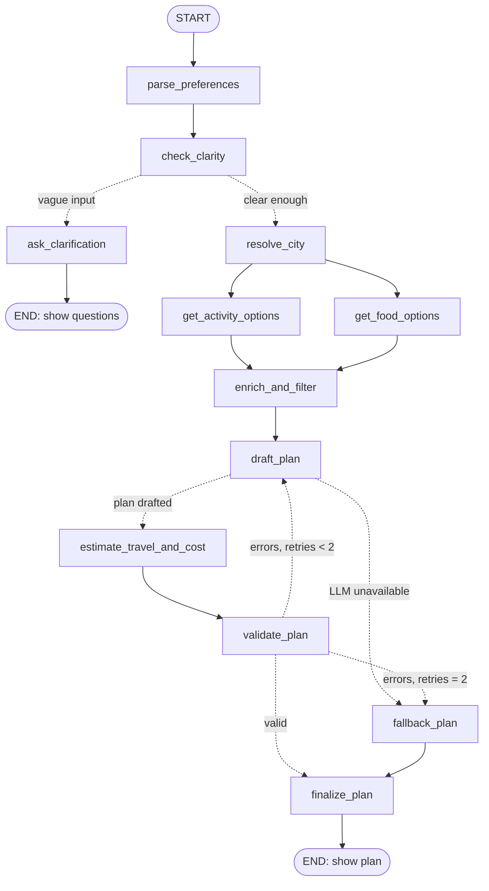

# Perfect Saturday Planner

An AI agent that turns your **city, budget, time, mood, interests and constraints** into a realistic, personalised Saturday plan made of **real places**. It explains why each stop fits you, is honest about trade-offs, and shows a **live trace** of every step it took.

**Live demo:** https://planner-agent-606.streamlit.app/

---

## Contents

1. [What it does](#1-what-it-does)
2. [How it works (at a glance)](#2-how-it-works-at-a-glance)
3. [Graph structure](#3-graph-structure)
4. [Nodes, one by one](#4-nodes-one-by-one)
5. [Shared state](#5-shared-state)
6. [Validation rules](#6-validation-rules)
7. [Data sources and estimates](#7-data-sources-and-estimates)
8. [Failure handling](#8-failure-handling)
9. [Agent trace](#9-agent-trace)
10. [User interface](#10-user-interface)
11. [Project structure](#11-project-structure)
12. [Run locally](#12-run-locally)
13. [Deploy](#13-deploy-streamlit-community-cloud)
14. [Design decisions](#14-design-decisions)
15. [Known limitations and next steps](#15-known-limitations-and-next-steps)

---

## 1. What it does

**Input** comes from a form or from free text:

```json
{
  "city": "Bangalore",
  "budget": 2000,
  "available_time": "4 hours",
  "start_time": "15:00",
  "mood": "tired but wants to do something fun",
  "interests": ["food", "music", "walks"],
  "constraints": ["vegetarian", "avoid crowded places"]
}
```

or: *"I'm in Mumbai, ₹1500, free from 4 to 9, want something chill and veg"*

**Output** is a plan with:

- A timeline of 1 to 4 stops. Each stop has a time slot, place, area, approximate cost and travel time from the previous stop.
- A **"why this fits you"** line per stop.
- **Trade-offs** ("slightly over budget, but quieter") and **caveats** (estimated hours, sample events).
- Total cost vs budget, the time window, and total travel time and distance.
- A data source badge per stop: `live data`, `curated data` or `template`.
- A map and a collapsible **agent trace**.

If the input is too vague, it asks **1 or 2 clarifying questions** instead of guessing.

---

## 2. How it works (at a glance)

The agent is a **LangGraph state graph** with 12 nodes. Each node does one job and calls plain Python tools, an external API or the LLM.

The core rule: **the LLM never invents places and never does arithmetic.**

- Geoapify supplies real places. Code enriches them and filters them into a list of candidates.
- The LLM only **chooses and orders candidate IDs**.
- Code works out the clock times, travel and cost, and **validates** the plan against 14 rules.
- If validation fails, the specific errors go back to the LLM, for up to 2 retries.
- If it still fails, or the LLM is unavailable, a **deterministic greedy planner** takes over.
- Finally the LLM writes the explanations, but it can't change places, times or prices.

The plan uses at most 4 LLM calls: parse, draft (plus a possible retry) and finalize. Most plans use 3.

---

## 3. Graph structure

Generated from the compiled graph (`build_graph().get_graph().draw_mermaid()`), with edge labels added. Solid arrows are fixed edges; dotted arrows are conditional routes.



Plain-text version, for terminals:

```
START
  │
  ▼
parse_preferences ──► check_clarity ──(vague)──► ask_clarification ──► END (questions)
                           │ clear
                           ▼
                      resolve_city
                    ┌──────┴───────┐                      (parallel fan-out)
                    ▼              ▼
     get_activity_options    get_food_options
                    └──────┬───────┘                      (fan-in: waits for both)
                           ▼
                   enrich_and_filter
                           │
            ┌────────► draft_plan ──(LLM unavailable)──────────┐
            │              │                                   │
            │              ▼                                   │
            │   estimate_travel_and_cost                       │
            │              │                                   │
            │              ▼                                   ▼
            └─(errors, ─ validate_plan ─(errors, retries=2)─► fallback_plan
             retries<2)    │ valid                             │
                           ▼                                   │
                     finalize_plan ◄───────────────────────────┘
                           │
                           ▼
                          END (plan)
```

The routing functions live in `app/graph.py`:

| Router | After node | Logic |
|---|---|---|
| `route_after_clarity` | `check_clarity` | If there are clarifying questions → `ask_clarification`, else → `resolve_city` |
| `route_after_draft` | `draft_plan` | If `llm_failed` → `fallback_plan`, else → `estimate_travel_and_cost` |
| `route_after_validate` | `validate_plan` | No errors → `finalize_plan`; `retries >= 2` → `fallback_plan`; otherwise → `draft_plan` |

---

## 4. Nodes, one by one

Every node is a function in `app/nodes.py`, wrapped by `@traced` so it records a trace line. Each one reads the shared state and returns only the fields it changes.

### 1. `parse_preferences`: understand the user
**Uses:** LLM (structured output into the `Preferences` model, temperature 0.2), with a regex fallback.

- Reads the raw form dict or free text.
- Extracts: city, budget (₹), available minutes, start time, mood, **energy** (low/medium/high, derived from mood), interests, diet and `avoid_crowds`.
- Free text like *"free from 4 to 9"* becomes start `16:00` and 300 minutes.
- Post-processing in code:
  - Interests are normalised to 9 known values (`museum` → `culture`, `coffee` → `food`, …).
  - Explicit form fields **override** the LLM (city, budget, start time, duration, and constraints like vegetarian or avoid crowds).
  - With no start time given, it assumes **15:00** and records that as an assumption shown to the user.
  - A window past midnight is cut to end at 23:59.
- **If the LLM fails:** `heuristic_parse` (regex rules) extracts the same fields, so the app still works.

### 2. `check_clarity`: is there enough to plan?
**Uses:** code only.

- **City missing** → asks *"Which city will you be in on Saturday?"*
- **2 or more of budget / time / interests missing** → asks about budget and time, or interests.
- At most **2 questions**.
- If only one thing is missing, it fills in a stated default instead of asking: ₹1500, 4 hours, or food + walks. The default is recorded as an assumption.
- On a follow-up (the user has already answered once), it **never asks again**. It fills defaults and plans.

### 3. `ask_clarification`: stop and ask
**Uses:** code only.

Sets `final = {"type": "clarify", "questions": [...]}` and ends the run. The UI shows the questions and an answer box. The answer is merged into the original input, and the graph runs again with `is_followup=True`.

### 4. `resolve_city`: where are we?
**Uses:** the Geoapify Geocoding API.

Tries three things in order:
1. **Live:** a Geoapify geocode restricted to India. It accepts only city-level results (city, county, district, suburb), so "Atlantis" doesn't match a building called *Atlantis* in Mumbai.
2. **Curated:** if the live lookup fails or finds nothing, it checks the mock dataset and its aliases (`bengaluru`, `blr`, `bombay`, …) for Bangalore, Mumbai and Delhi.
3. **Generic:** otherwise, a template plan with a clear note: *"We couldn't find 'Atlantis'…"*

Writes `city = {coords, source, city_key, name, note}`.

### 5. `get_activity_options` and 6. `get_food_options`: find real places (in parallel)
**Uses:** the Geoapify Places API, plus rule-based enrichment (`app/rules.py`).

Both branches run **at the same time** and join at `enrich_and_filter`.

- **Activities:** interests map to Geoapify categories (walks/nature → parks and natural areas; art/culture → museums, culture, sights; books → bookstores; music/nightlife → culture, bars, pubs; shopping → malls and markets).
- **Food:** restaurants and cafés. If the user is vegetarian or vegan, the query adds Geoapify's `conditions=vegetarian`.
- Searches within **8 km** of the city centre, and widens to **15 km** if there are fewer than 5 results. It fetches up to 100 results, because many OSM places have no name.
- With a budget under **₹500**, parks are always searched too, even if the user didn't mention walks or nature, so there are free options.
- Each raw result is **normalised** into a `Place`:
  - subcategory and interests (from Geoapify categories)
  - **cost** (₹ table by type), **crowd** (Saturday morning/afternoon/evening rules by type) and **energy**
  - **Saturday opening hours**, parsed from OSM's `opening_hours` text (e.g. `Mo-Fr 09:00-18:00; Sa 10:00-14:00`). If missing, category defaults are used and the hours are flagged as estimated.
  - Places closed on Saturdays are dropped. Duplicates by name are removed.
- With fewer than 3 live results or an API error, it tops up with **curated** places (including one labelled *sample event* per city) or **generic** templates.

### 7. `enrich_and_filter`: keep only places that make sense
**Uses:** code only.

Hard filters:

| Filter | Rule |
|---|---|
| Diet | Vegetarian/vegan users only see food stops marked `pure_veg` or `veg_options` |
| Energy | Low-energy users never see `high` energy places (e.g. a national park trek) |
| Budget | Drops any place that costs more than the whole budget |
| Open | The place must be open for at least `min(typical visit, 45 min)` inside the user's window (e.g. museums disappear for a 21:00 start) |

The survivors are ranked by a **fit score**: interest matches, energy match, crowd level (when avoiding crowds), cost relative to budget and pure-veg bonus, with a small penalty for sample events. It keeps the **top 15 activities and top 10 food places**. If fewer than 3 remain, it adds generic templates. The trace shows how many were dropped and why.

### 8. `draft_plan`: the LLM picks the plan
**Uses:** LLM (structured output into `DraftPlan`, temperature 0.2).

- The LLM gets the preferences, the time window, the budget, and the candidate list: id, name, type, area, lat/lon, cost, hours, crowd, energy, veg and typical duration.
- It returns **only an ordered list of candidate IDs**, with an optional duration per stop, plus a one-line rationale.
- How many stops depends on the window: under 90 min → 1; under 3 h → 2; under 5 h → 3; otherwise up to 4.
- **On a retry**, it also gets its previous attempt and the exact validation errors, e.g. *"Madras Kitchen is closed when you'd arrive at 22:36 (Saturday hours 11:30-22:30). Visit it earlier in the order or replace it."*
- If the LLM is unreachable (missing key, network or auth error), it sets `llm_failed` and the graph routes straight to `fallback_plan`. Malformed output becomes an empty plan, which validation rejects, so it's retried.

### 9. `estimate_travel_and_cost`: put the plan on the clock
**Uses:** the Geoapify Route Matrix API, plus code.

- **Travel per leg** comes from the Route Matrix (drive mode, `traffic=approximated`). Routing times are optimistic for Indian traffic, so each leg is at least **20 km/h** plus 5 minutes for pickup or parking. If the API fails, it uses straight-line distance × 1.35 at 20 km/h.
- **Schedule** (`build_schedule`): stops are placed one after another starting at the start time.
  - If a place isn't open yet on arrival, the stop waits for it to open.
  - Each stop lasts between 30 and 180 minutes. If the whole window is shorter than 30 minutes, one stop fills the window.
  - A stop is shortened to end at closing time or at the end of the window, if at least 30 minutes remain.
- **Cost** = the sum of the stops' per-person prices. Travel costs are not included.

### 10. `validate_plan`: check everything in code
**Uses:** code only.

Runs the 14 rules in [section 6](#6-validation-rules). Each issue is either an **error** (the plan is not acceptable) or a **warning** (acceptable, but explained to the user as a trade-off). Errors increment `retries`, and the router decides where to go next.

### 11. `fallback_plan`: deterministic safety net
**Uses:** code only.

Runs when the LLM is unavailable or validation has failed twice. It's a **greedy planner**:

1. Starting at the start time, look at every unused candidate.
2. Skip it if the leg is over 60 minutes, it isn't open, less than 30 minutes would remain, or it doesn't fit the remaining budget.
3. Score it: fit score, a bonus for covering a new interest, and penalties for travel time, waiting and two meals in a row.
4. Add the best one, move the clock forward and repeat. Stop at the maximum number of stops or when less than 40 minutes are left.

If nothing fits the budget, it reruns favouring the cheapest options and adds a note: *"the cheapest workable plan is ₹X, about ₹Y over. Free options nearby: …"*. The result goes through the same travel, schedule and validation code, so the numbers are consistent.

### 12. `finalize_plan`: explain it honestly
**Uses:** LLM (structured output into `FinalNarrative`, temperature 0.6), with a template fallback.

- Builds the final output: each stop's details, times, travel, cost, crowd at that time, veg status, source and estimated fields.
- The LLM writes a **headline**, a **summary**, one **"why this fits you"** sentence per stop, and **trade-offs** (it's told to turn the validation warnings into honest trade-offs). It's told not to add or rename places or change times or prices.
- Code adds **caveats**: sample events aren't real listings, template stops aren't specific venues, some hours are estimated, prices and crowds are estimates, and any constraint that couldn't be met.
- **If the LLM fails:** template reasons from the data, e.g. *"Covers your interest in walks, usually quiet around 16:00, free."*

---

## 5. Shared state

`PlannerState` (`app/models.py`) is the TypedDict passed between nodes:

| Field | Written by | Meaning |
|---|---|---|
| `raw_input` | caller | Form dict or free text |
| `is_followup` | caller | True when answering clarifying questions, so it never asks twice |
| `prefs` | parse, check_clarity | The `Preferences` model |
| `clarifying_questions` | check_clarity | 0 to 2 questions |
| `city` | resolve_city | coords, source (`live`/`mock`/`generic`), mock key, name, note |
| `activity_candidates`, `food_candidates` | parallel fetch nodes | Separate keys so the parallel branches don't overwrite each other |
| `candidates` | enrich_and_filter | Filtered, ranked `Place` list |
| `data_source` | enrich_and_filter | The best source used |
| `plan` | draft → estimate → fallback | List of `Stop` (place_id, start, end, travel) |
| `plan_rationale` | draft_plan | The LLM's one-line rationale |
| `cost` | estimate, fallback | Per-stop and total ₹, plus travel km |
| `issues` | validate, fallback | Errors and warnings |
| `retries` | validate_plan | Number of failed validations |
| `llm_failed`, `used_fallback` | draft, fallback | Routing and labels |
| `notes` | resolve_city, fallback | User-facing notes (unknown city, tight budget) |
| `final` | ask_clarification, finalize | What the UI renders |
| `trace` | every node (via `@traced`) | Append-only list (an `operator.add` reducer) |

---

## 6. Validation rules

From `validate_plan` in `app/tools.py`:

| # | Rule | Level |
|---|---|---|
| 1 | Every `place_id` exists in the candidates (no invented places) | error |
| 2 | No duplicate stops | error |
| 3 | Stop count: 1 for windows under 90 min, otherwise 2 to 4 | error |
| 4 | Total cost ≤ budget. Up to 10% over is a warning; more is an error | error / warning |
| 5 | The plan ends within `start_time + available time` | error |
| 6 | Each stop is open for its **whole** slot (with a reason: closed on arrival vs closes mid-visit) | error |
| 7 | Each stop gets at least 30 minutes | error |
| 8 | No leg over 60 minutes | error |
| 9 | Total travel ≤ 30% of the available time | error |
| 10 | Vegetarian/vegan: every food stop is `pure_veg` or `veg_options` | error |
| 11 | Low energy: no `high` energy stops | error |
| 12 | Avoid crowds: no stop that is `busy` in its time slot | warning |
| 13 | Waiting more than 30 minutes for a place to open | warning |
| 14 | The user's top interests are covered, where candidates allow | warning |

---

## 7. Data sources and estimates

| Field | Source | Shown to the user as |
|---|---|---|
| Place name, coordinates, area | Geoapify Places (OpenStreetMap) | real |
| Travel time and distance | Geoapify Route Matrix, with the traffic floor | real, approximate |
| Vegetarian | Geoapify `vegetarian` / `vegetarian.only` tags | "pure veg" / "veg options" badge |
| Opening hours | OSM `opening_hours` if present, else category defaults | flagged when estimated |
| Cost | ₹ table by type (`rules.COST_BY_SUBCATEGORY`), free/fee tags | "approx" |
| Crowd level | Saturday rules by type and time of day (`rules.CROWD_RULES`) | "quiet / moderate / busy at this time" |
| Energy | Rules by type | internal |
| Ratings | Not available | skipped rather than faked |
| Events | Mock data only | "sample event" badge |

**Fallback data** (`data/mock_data.json`): about 10 well-known real places each for Bangalore, Mumbai and Delhi, one sample event per city, and generic templates ("a quiet neighbourhood café"). It uses the same schema as the enriched live data, so the rest of the pipeline doesn't care where the data came from.

---

## 8. Failure handling

| Case | Detection | Behaviour |
|---|---|---|
| Vague input ("something fun") | `check_clarity` | Asks 1 to 2 targeted questions and never asks twice |
| Unknown or non-Indian city ("Atlantis") | Geocode returns no city-level match | Generic template plan with a clear note |
| Geoapify down, rate-limited or no key | Timeout, 4xx/5xx or missing key | Curated data for that city; the trace shows `source=mock` |
| Too few matches | Fewer than 5 results, or fewer than 3 candidates | Widens to 15 km, then tops up with curated or generic places |
| Budget too tight | Greedy finds nothing within budget | Cheapest plan, the gap in ₹, and free alternatives |
| ₹0 budget | Budget is 0, not missing | Free places only (parks, free museums); never replaced by the default |
| Late start or short window | Hours filter and stop-count rule | Closed places removed; under 90 min gets 1 stop, under 30 min gets 1 stop filling the window; if nothing is open, the plan says so |
| LLM returns bad JSON or an unknown ID | Pydantic error or validation rule 1 | Counts as a failed attempt and is retried with feedback |
| Validation fails twice | `retries >= 2` | Deterministic `fallback_plan` |
| OpenAI down or no key | `LLMUnavailable` | Regex parsing, greedy planner and template explanations: a full plan with no LLM |
| Unexpected exception | UI guard | A friendly error message instead of a stack trace |

---

## 9. Agent trace

The `@traced(step)` decorator (`app/trace.py`) times every node and adds an event to `state["trace"]`:

```python
{"step": "get_food_options", "status": "ok", "source": "live",
 "summary": "42 places from Geoapify", "ms": 412}
```

Statuses: `ok` ✅, `retry` 🔁, `fallback` 🛟, `error` ⚠️, `needs_input` ❓, `skipped` ⏭️.

The UI runs `graph.stream(state, stream_mode="updates")` and writes each event into an `st.status` box **as it happens**. When planning finishes, the box collapses and the full trace is kept in a table under the plan. Example from a real run:

```
✅ parse_preferences          via LLM: city=Bangalore, budget=₹2000, 240 min from 15:00, energy=low, ...
✅ check_clarity              enough detail to plan
✅ resolve_city        live   Bengaluru at 12.977,77.590: geocoded via Geoapify
✅ get_activity_options live  74 places from Geoapify
✅ get_food_options    live   42 places from Geoapify
✅ enrich_and_filter   live   116 found → 25 candidates
✅ draft_plan                 attempt 1: MS Building Park → La Bonita Confiteria → Cubbon Park
✅ estimate_travel_and_cost   legs: 18 min/2.8 km, 30 min/5.2 km; total ₹400
✅ validate_plan              valid | 1 warning(s)
✅ finalize_plan              explanations via LLM
```

---

## 10. User interface

`streamlit_app.py`:

- **📝 Form tab:** fields matching the JSON input, prefilled with the brief's example.
- **💬 Describe it tab:** a single free-text box.
- **Clarification flow:** the questions, an answer box and a *Continue* button. The answer is merged into the original input.
- **Plan view:** headline and summary; metrics for total cost vs budget, time window and travel time/distance; a card per stop with badges (data source, pure veg / veg options, crowd at this time, sample event) and the "why" line; travel between stops; trade-offs; an expander for caveats and assumptions; a map.
- **Sidebar:** whether the LLM and Geoapify keys are set, and example inputs to try.

---

## 11. Project structure

```
Planner_agent/
├── streamlit_app.py        # UI: form + free-text tabs, live trace, plan cards, clarification flow
├── app/
│   ├── graph.py            # LangGraph wiring, routing functions, run() helper
│   ├── nodes.py            # The 12 node functions + LLM prompts
│   ├── tools.py            # City/places/travel tools, scheduling, cost, validation, greedy fallback
│   ├── llm.py              # OpenAI structured-output helper + regex fallback parser
│   ├── models.py           # Pydantic models (Preferences, Place, Stop, LLM schemas) + PlannerState
│   ├── rules.py            # Cost / crowd / energy / hours / category tables
│   ├── data_sources.py     # Geoapify REST client (TTL cache), opening-hours parser, mock loader
│   └── trace.py            # @traced decorator
├── data/mock_data.json     # Curated fallback data (3 cities + generic templates)
├── tests/test_validate.py  # 30 offline tests: rules, scheduler, fallback, parsers, full graph
├── .streamlit/secrets.toml.example
├── .env.example
├── requirements.txt
├── SPECS.md                # Original design spec
└── README.md
```

---

## 12. Run locally

```bash
# 1. Install (Python 3.12)
uv venv -p 3.12 .venv && uv pip install -p .venv -r requirements.txt
#    or: python3.12 -m venv .venv && .venv/bin/pip install -r requirements.txt

# 2. Keys
cp .env.example .env        # then fill in the keys

# 3. Run the app → http://localhost:8501
.venv/bin/streamlit run streamlit_app.py

# 4. Tests (offline; no keys or network needed)
.venv/bin/python -m pytest -q
```

| Variable | Required | Notes |
|---|---|---|
| `OPENAI_API_KEY` | no* | Without it the app runs in rule-based mode |
| `OPENAI_MODEL` | no | Defaults to `gpt-4.1-mini` |
| `GEOAPIFY_API_KEY` | no* | Free tier of 3,000 credits/day. Without it the app uses curated data |

\*Needed for the full experience. The app works with neither key.

---

## 13. Deploy (Streamlit Community Cloud)

1. Push the repo to GitHub. `.env` and `.streamlit/secrets.toml` are git-ignored.
2. At [share.streamlit.io](https://share.streamlit.io), create a new app and choose the repo, branch `main` and main file `streamlit_app.py`.
3. Under **Settings → Secrets**, paste:
   ```toml
   OPENAI_API_KEY = "sk-..."
   OPENAI_MODEL = "gpt-4.1-mini"
   GEOAPIFY_API_KEY = "..."
   ```
4. Open the URL in an incognito window and try: the prefilled form, *"something fun this weekend"*, and the city *"Atlantis"*.
5. Every push to `main` redeploys the app automatically.

---

## 14. Design decisions

- **A graph, not one giant prompt.** Each step is a small, testable unit. Retries and fallbacks are explicit edges, and the trace falls out naturally.
- **A fixed graph, not free ReAct tool calling.** The flow is known in advance, so a fixed graph is cheaper, faster and more predictable for reviewers.
- **The LLM picks IDs; code does the maths.** No invented places, no arithmetic mistakes, and every number on screen is computed in code.
- **Concrete feedback on retries.** Validation messages say *why* and *what to do* ("closed when you'd arrive at 22:36… visit it earlier"). This visibly improves the second attempt.
- **Geoapify REST rather than an MCP server.** Deterministic tools we control suit a constrained planner. MCP fits open-ended assistants better.
- **Honest data.** Estimates are labelled, ratings are skipped rather than faked, and sample events are marked.
- **India scope.** Costs are in ₹ and the crowd and cost rules are tuned for Indian cities, so geocoding is restricted to India.
- **Cheap to run.** A small model, 3 to 4 LLM calls per plan, and Geoapify responses cached for 24 hours.

---

## 15. Known limitations and next steps

**Limitations**
- Crowd levels and prices are rule-based estimates.
- OSM data in India is sparse in places, and unnamed parks and cafés are skipped.
- No live events or booking availability.
- Travel times assume driving; there's no public transit. Travel costs aren't included in the total.
- Plans start from the city centre, not the user's location.

**Next steps**
- Use the user's location instead of the city centre.
- A "swap this stop" action that re-runs only `draft_plan` with a constraint.
- A real events API.
- Evals on a fixed set of personas (T1 to T7 in `SPECS.md`).

---

## AI usage

_TODO: 2 to 3 lines on how AI tools were used during the build._
